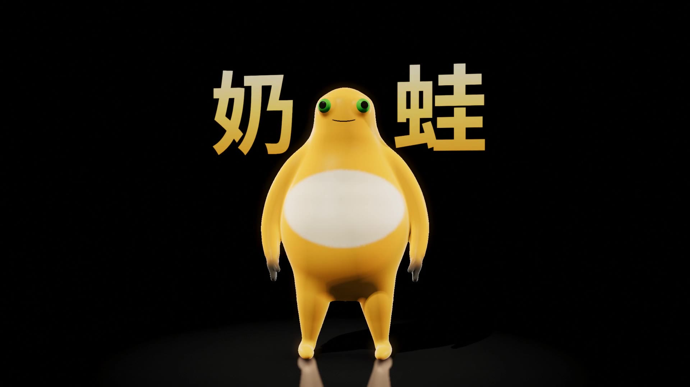
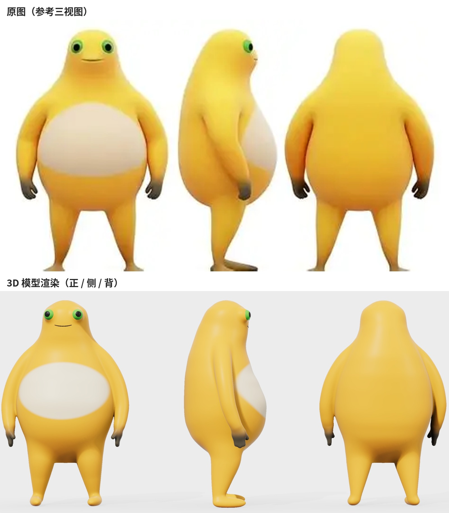
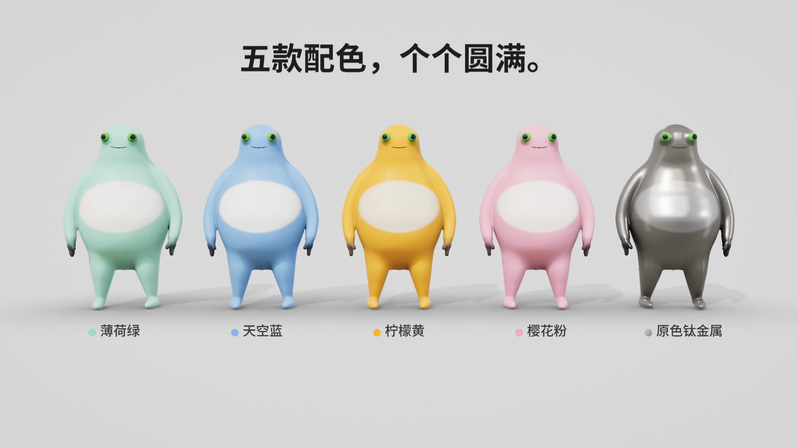

# 奶蛙 · 3D 模型素材



黄色圆滚滚的「奶蛙」角色 3D 模型，根据正 / 侧 / 背三视图还原，可直接导入 Blender、C4D、Unity、Three.js 等复用。



## 文件

| 路径 | 说明 |
| --- | --- |
| `models/naiwa_yellow.glb` | 原色（柠檬黄） |
| `models/naiwa_mint.glb` | 薄荷绿 |
| `models/naiwa_sky.glb` | 天空蓝 |
| `models/naiwa_pink.glb` | 樱花粉 |
| `models/naiwa_titanium.glb` | 原色钛金属（金属材质） |
| `previews/` | 预览图 |
| `source/` | 建模与渲染源码（可重新生成模型、改造型） |



## 模型规格

- 格式：glTF 2.0 二进制（`.glb`），单位约为米，身高 2.0，脚底在 y = 0，面朝 +Z
- 约 40 万三角面，4 个部件：`Body`、`Eye_L`、`Eye_R`、`Mouth`
- 颜色存在顶点色（`COLOR_0`）里，没有贴图文件、没有 UV
- 白肚皮、渐变暗色指尖、脚底都是顶点色过渡

## 使用提示

- **Blender**：文件 → 导入 → glTF 2.0。顶点色会自动接到材质的基础色上；如果显示成白色，在材质里加一个「颜色属性」节点接到 Base Color。
- **需要贴图 / 做动画**：模型没有 UV 和骨骼。在 Blender 里可以先做智能 UV 展开，再把顶点色烘焙成贴图；动画需要自己绑骨（Rigify 或 Mixamo）。
- **想减面**：Blender 里加「精简（Decimate）」修改器，比例 0.25 左右仍然很圆润。

## 源码

`source/model.py` 用有符号距离场（SDF）平滑拼接身体、手臂、腿、眼窝，marching cubes 出网格，再烘焙顶点色和环境光遮蔽。依赖 `numpy`、`scipy`、`scikit-image`：

```bash
python3 model.py   # 生成 character.glb 与渲染用的 assets/
```

`engine.js` / `scenes.js` / `timeline.js` / `page.html` / `rec.mjs` 是宣传片用的 WebGL 渲染器和时间线（无头 Chrome + Playwright + ffmpeg），`sfx.py` 合成片中音效。
